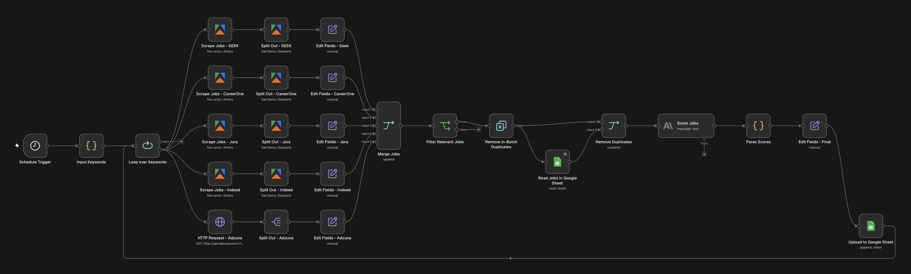
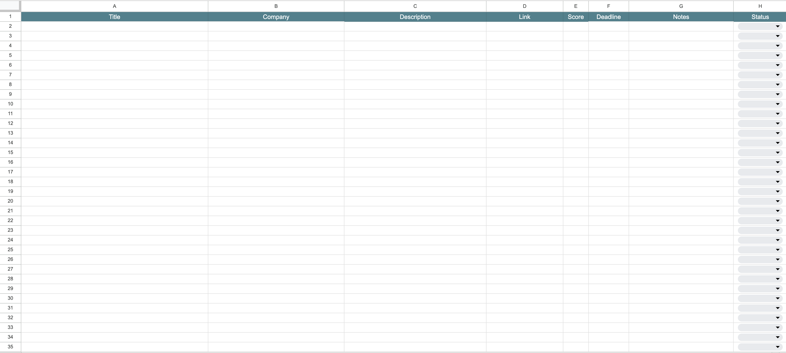
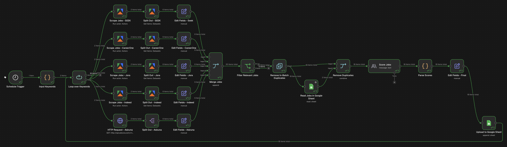
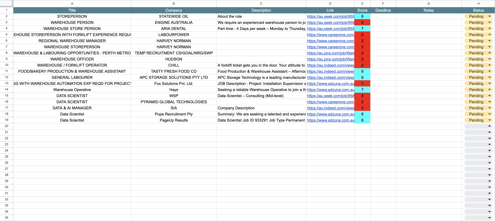

# Project Overview

This is an automated job search project that uses the AI workflow automation platform, n8n, to automaticlly scrape jobs and upload them into Google Sheets. It offers benefits to job seekers by eliminating the time-consuming task of manually searching for jobs, thereby saving time for more important tasks such as resume and cover letter writing. In addition, it allows a single environemnt where job seekers can keep track of their job applications. 

The following two images shows the workflow and speadsheet used.

The next two images shows what they look like after executing the workflow with the search terms "warehoues" and "data scientist".  

The spreadsheet uses 8 columns to store job information. For the sake of completeness, they are:
- Title: title of the job
- Company: company advertising the job
- Description: description of the job (some entries are blank, which are due to the job itself not having a description or the particular scraper being unable to collect such information)
- Link: link to the job post
- Score: score out of ten that rates how well a candidate is suited to the job
- Deadline: user may put in a deadline for application if they do not wish to apply immediately
- Notes: user may put any notes they may have for the job
- Status: status of the job application (currently has values for Pending, Applied, Rejected, and Unqualified)

The spreadsheet also uses conditional colour formatting for the Score and Status columns for ease of use. 

Both the workflow and sheet has been provided in this repo.

# Limitations
- Use of n8n cloud requires a monthly subscription (running it locally is free however)
- Using the job scrapers require Apify credits, and if the amount used exceeds the free limit, payment will be required to top it up

